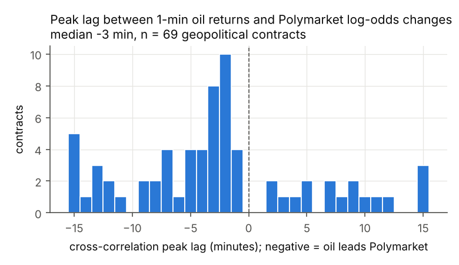

## Abstract

Do prediction markets lead conventional financial markets on geopolitical events? Using minute-level prices for 81 Polymarket contracts on the US-Iran conflict, the Strait of Hormuz, Russia-Ukraine, Israel, Venezuela, Taiwan and tariffs (2024 to October 2026, $3.1 billion in volume) and minute bars for oil, energy, defense, Treasury, gold and equity ETFs, I find that the answer depends on whether both venues are open. When US ETFs are closed, the move in Polymarket's odds on Iran and Hormuz contracts predicts the oil ETF's gap at the next open (USO t = 4.5 over 445 closures with errors clustered by closure; overnight and weekend closures replicate separately; control contracts and a shuffle placebo are null). When both venues are trading, the direction reverses: oil has moved 42 basis points in the 15 minutes before a Polymarket jump (t = 6.3) against 12 basis points in the 30 minutes after, and Granger tests run from oil to Polymarket in 24 percent of contract pairs against 8 percent in the other direction, with a cross-correlation peak at a 3 minute oil lead. The reopen gap is realized at the opening print; a rule that follows closed-hours jumps into USO at the open loses 15 basis points per trade. Prediction markets are not faster than oil futures. They are open when oil futures are not. This reconciles the election-night lead reported by Aktug and Torul (2026) with the weak daily transmission in Azqueta-Gavaldón and Ureta (2026): the lead is a trading-hours effect and the transmission is concentrated in the first minute after the open.

## 1. Introduction

Polymarket settled $54 billion of contracts between 2021 and early 2026, and during the 2026 US-Iran war its contracts on strikes, ceasefires and the Strait of Hormuz became its most liquid non-election markets. Watchdog reports and a federal indictment documented wallets that bet on military operations hours before they were public. These facts raise a question for market microstructure: does information in these contracts reach the conventional markets that price the same events, and if so, which market moves first?

The existing evidence points in two directions. Aktug and Torul (2026) study the 2024 US presidential election across nine prediction venues and, in a cross-asset section, report that Polymarket reached each milestone of its election-night move 15 to 225 minutes before E-mini S&P futures, with two weekend shocks showing Polymarket repricing while CME was closed. They conclude that "prediction markets incorporate political information ahead of deep, professionally arbitraged financial markets." The evidence is one night and two weekends. Azqueta-Gavaldón and Ureta (2026) build a geopolitical risk index from open-source intelligence channels and find that its daily transmission to energy equities is statistically weak. If the first paper is right, the second should have found something. One way to reconcile them is that the lead exists but lives inside the day, in the hours when one venue trades and the other does not.

This paper tests that directly. I assemble 81 Polymarket contracts on geopolitical events, grouped into 50 distinct event clusters, with minute-resolution price histories, and align them with minute bars for nine ETFs. Four designs separate the closed-hours case from the open-hours case. The closed-hours design regresses each ETF's reopen return on the Polymarket move accumulated during the closure, so simultaneity is impossible by construction. The open-hours design is an event study around Polymarket jumps during ETF trading hours, where the pre-jump window asks whether the ETF had already moved. Granger causality and transfer entropy on overlapping minutes give the direction. A backtest gives economic significance.

The results are consistent across designs. During closures, the Polymarket move predicts the oil ETF gap with t-statistics above 4, and the effect comes entirely from contracts about oil supply (US-Iran conflict and Hormuz traffic). During trading hours, oil moves first and Polymarket follows within minutes. The gap cannot be captured after the open. The contribution is not that prediction markets are fast. It is that they are open.

## 2. Data

### 2.1 Polymarket contracts

Contracts were selected from the Polymarket Gamma API by topic tag (geopolitics, tariffs, Ukraine, Venezuela, oil) and ranked by volume. The sample contains 81 contracts with a plausible link to a traded asset and 10 control contracts (sports championships, entertainment releases) with no such link, chosen to have comparable volume and timing. Table A1 lists every contract. Many contracts are "ladder" siblings that ask the same question with different deadlines ("US strikes Iran by January 31", "by February 28"); for inference these are grouped into event clusters defined by category, direction and the first three words of the question, giving 50 clusters among treated contracts.

Each contract is assigned an escalation sign: +1 if YES means more conflict or supply disruption, -1 if YES means a ceasefire, a deal or traffic returning to normal. Asset hypothesis signs are the product of the escalation sign and a template (oil and energy +1, equities -1, Treasuries and gold +1 on escalation), with category-specific adjustments listed in Appendix A. Signs are assigned per contract, not per category. An earlier pass with category-level signs produced a spurious result on defense stocks, because ceasefire and strike contracts within the same category were coded in the same direction and cancelled into noise once corrected (Appendix C).

Price histories come from the CLOB price-history endpoint at one-minute fidelity. The series is a quote, not a trade print; it moves only when the book moves. Each series is placed on a one-minute UTC grid with forward fill and a staleness counter. Coverage is high: the median contract has a fresh quote in 99.7 percent of minutes and the minimum is 90 percent.

Two artifacts were found and removed. At 01:01 UTC on 27 December 2025, thirteen unrelated contracts snapped to exactly 0.50 in the same minute, which is Polymarket's empty-book default; this is a feed outage, not news. Jumps in minutes where three or more contracts move together, and jumps whose post-price is exactly 0.50, are flagged and dropped (45 of 4,042). Closures that span the 27 December minute or whose endpoint is exactly 0.50 are dropped from the closed-hours design (228 of 38,040 rows). Results are unchanged without these filters.

### 2.2 ETFs

Minute bars for USO (crude oil), XLE (energy equities), ITA, LMT and RTX (defense), GLD (gold), TLT (long Treasuries), SPY and VIXY come from Massive (formerly Polygon.io), October 2024 to October 2026, including pre-market and after-hours sessions (04:00 to 20:00 ET). The main results use the empirical session, treating any minute with a bar as open. A robustness run restricts to the regular session (09:30 to 16:00 ET), which makes every overnight a closure.

### 2.3 Summary

Treated contracts produce 4,367 jumps by the detector described below, of which 72 percent occur while the ETFs are closed under the extended-hours definition. The 430 jumps of ten points or more are listed in the replication package with a template for headline timestamps (Section 6).

## 3. Designs

### 3.1 Closed-hours gap

For each closure c of an ETF (a gap of at least two hours between bars), let x_c be the change in the contract's log-odds from the last open minute to the first reopen minute, and y_c the ETF's log return from the last close to h minutes after reopening, signed by the hypothesis. The regression is y_c = a + b x_c + g x_pre,c + e_c, where x_pre,c is the contract's log-odds move in the six hours before the close, included so that a move the ETF had already seen does not count. Every contract shares the same closures, so standard errors are clustered by closure. The main sample keeps one row per event cluster per closure, the row with the largest |x_c|. x_c is winsorized at the first and 99th percentiles.

The design cannot suffer from simultaneity. During the closure the ETF does not trade, so y_c is measured after x_c ends.

### 3.2 Event study during trading hours

Jumps in the Polymarket series are detected with a Lee and Mykland (2008) statistic on log-odds changes, with the local volatility floored at 0.02 per minute so that a dead market cannot produce spurious jumps, combined with a threshold of ten probability points over five minutes. Jumps within 30 minutes of each other are merged. For jumps while the ETF is open, the signed return is computed from the ETF close at t-1 to t+h for h in {1, 5, 15, 30, 60}, and over the window [t-15, t-1] and [t-5, t-1] before the jump. A placebo distribution is built from 300 random open minutes per contract-asset pair, at least 60 minutes from any real jump, with random sign.

The pre-jump windows are the diagnostic. If the ETF has already moved before the Polymarket jump, Polymarket did not lead.

### 3.3 Lead-lag on overlapping minutes

On minutes where the ETF is open and the Polymarket quote is at most 30 minutes old, I estimate Granger causality in both directions with five lags and Newey-West errors, transfer entropy with quantile-binned series and a 100-shuffle surrogate p-value, and the lag at which the cross-correlation between one-minute log-odds changes and one-minute ETF returns peaks.

### 3.4 Tradability

For each jump of at least five points, enter the ETF at the next tradable minute (one minute after the jump if open, the first open minute otherwise) in the hypothesized direction, hold 30 minutes, pay one basis point per side.

### 3.5 Validation

Every module is tested on synthetic data with a known lead-lag, in both directions, and recovers the planted structure (Appendix B).

## 4. Results

### 4.1 Closed hours

Table 1 reports the closed-hours regression pooled over all treated contracts, for the extended-hours and regular-hours definitions of the session.

**Table 1. Closed-hours gap regression, pooled over geopolitical contracts.**
Dependent variable: signed ETF log return from last close to 30 minutes after reopen. One row per event cluster per closure. Standard errors clustered by closure.

| | | Extended hours | | | Regular hours | | |
|---|---|---|---|---|---|---|---|
| Asset | | n | clusters | t | n | clusters | t |
| USO | | 2305 | 466 | **4.06** | 2204 | 445 | **4.47** |
| XLE | | 2426 | 485 | **3.75** | 2204 | 445 | **3.97** |
| VIXY | | 3345 | 478 | 3.06 | 3088 | 445 | 2.66 |
| TLT | | 3152 | 450 | -1.36 | 3088 | 445 | -2.35 |
| SPY | | 3152 | 450 | 2.01 | 3088 | 445 | 1.97 |
| GLD | | 3162 | 452 | -0.11 | 3088 | 445 | -1.14 |
| ITA | | 4018 | 672 | -1.00 | 2608 | 445 | -1.94 |
| LMT | | 3820 | 640 | 0.92 | 2608 | 445 | 1.23 |
| RTX | | 3699 | 637 | 0.45 | 2608 | 445 | -0.40 |

Slopes for USO are 0.011 (extended) and 0.017 (regular) in log return per unit of log-odds. Under the regular-hours definition, a contract moving from 50 to 73 percent during a closure predicts a 1.7 percent move in USO by 30 minutes after the open. The effect is present in the first minute of trading (USO t = 4.09 at h = 1 under extended hours, 4.41 under regular hours). Overnight closures alone (345 clusters, t = 3.5) and weekend closures alone (100 clusters, t = 2.6) each replicate. The pre-closure control, the contract's move in the twelve hours before the close, has t = 0.2 for USO under extended hours and 1.9 under regular hours; the closure slope is estimated net of it. VIXY, the volatility ETF, also responds (t = 3.1 extended, 2.7 regular), driven by the Venezuela contracts (t = 2.6) rather than the oil ones (t = 1.5 to 1.9).

Figure 1 shows the relation for Iran and Hormuz contracts as a binned scatter. All twenty bin means lie on the fitted line.

By category, the effect comes from the two groups of contracts about oil supply. Iran contracts give XLE t = 3.7 and USO t = 3.6 over 223 clusters. Hormuz contracts give USO t = 3.9 with a slope of 0.028 over 105 clusters. Ukraine, Israel, Taiwan, tariff and other military contracts show nothing on oil. Venezuela contracts show nothing on oil but move VIXY (t = 2.6) and SPY (t = 2.3). Defense ETFs show nothing on any contract. Control contracts are null on every asset (largest |t| 1.3).

Two checks address the concern that both series were volatile in the same months. Permuting each contract's closure moves across its own closures, which preserves the marginal distributions and destroys the pairing, leaves oil and VIXY null (USO t = 0.8, XLE 1.8, VIXY -1.0; the largest placebo |t| across nine assets is 2.1, on ITA, which has no real effect). Regressing the contract's closure move on the ETF's return in the last hour before the close, the reverse direction, gives |t| below 1.6 for every asset.

### 4.2 Trading hours

Table 2 reports the signed return around Polymarket jumps that occurred while the ETF was open, for Iran and Hormuz contracts.

**Table 2. Signed ETF return around Polymarket jumps during trading hours, Iran and Hormuz contracts.**
Basis points, weighted by jumps per contract; t across 35 contracts.

| Window | USO bp | USO t | XLE bp | XLE t |
|---|---|---|---|---|
| [-15, -1] before jump | **41.7** | **6.27** | 9.6 | 5.12 |
| [-5, -1] before jump | 19.6 | 5.26 | 4.9 | 4.24 |
| +1 after | 2.5 | 1.56 | 0.9 | 1.07 |
| +5 | 5.5 | 1.97 | 3.7 | 3.76 |
| +15 | 8.6 | 2.34 | 5.2 | 3.56 |
| +30 | 12.0 | 3.20 | 8.5 | 4.38 |
| +60 | 6.5 | 1.69 | 10.3 | 3.56 |

Oil has moved 42 basis points in the fifteen minutes before the Polymarket jump and 20 in the five minutes before it. The post-jump drift of 12 basis points over 30 minutes is a quarter of the pre-jump move. Control contracts show no pre-jump movement (USO 1.3 bp over [-15, -1]). Figure 2 plots the profile.

### 4.3 Direction on overlapping minutes

Among Iran and Hormuz contract pairs with USO, Granger causality from oil to Polymarket is significant at 5 percent in 24 percent of pairs; from Polymarket to oil in 8 percent. Fisher's combined p-value across the 68 treated USO pairs is 1e-13 for oil to Polymarket and 0.06 for Polymarket to oil. The cross-correlation peak lag has a median of -3 minutes for USO and -2 for XLE, where negative means oil leads (Figure 3).

 Transfer entropy is significant in both directions for most pairs and does not separate them; sparse Polymarket updates inflate it, so Granger and the cross-correlation lag are the cleaner reads.

### 4.4 Tradability

Following each closed-hours jump on an Iran or Hormuz contract into USO at the next open and holding 30 minutes yields a mean of -15.4 basis points per trade over 283 trades (t = -2.4), with a hit rate of 47 percent. Restricting to jumps of ten points or more does not help (-20 bp, 90 trades). Open-hours jumps entered one minute later yield +7 bp (t = 1.3). Control contracts yield nothing in either case.

The reopen gap in Table 1 and the loss in the backtest are the same fact seen twice. The gap is realized at the opening print. By the first minute at which a trader can transact, it is priced, and the next 30 minutes revert.

## 5. Interpretation

The four designs describe one mechanism. When oil futures and ETFs trade, they impound geopolitical news two to four minutes before Polymarket does; Polymarket is a follower in continuous time. When they are closed, Polymarket keeps pricing, and the move it accumulates overnight or over a weekend is impounded by oil at the opening print. The informational content of prediction-market prices for conventional assets is an artifact of trading hours, not of speed.

This reconciles the two prior findings. Aktug and Torul's election-night milestones were measured from 22:00 UTC, after the US close, and their weekend shocks were by construction during a CME closure. Their design selected the closed-hours regime, in which prediction markets do lead. Azqueta-Gavaldón and Ureta's daily SVAR averaged over the whole day, in which oil leads during the 6.5 hours both are open and the overnight gap is one minute of 390. Their weak daily transmission is the expected result of a minute-level effect concentrated at the open.

Three caveats apply. First, the Polymarket series is a quote that moves only when the book moves, so on thin contracts the detected jump minute can lag the information minute by a few minutes. This biases the open-hours event study toward finding pre-jump ETF movement and biases against Polymarket leadership; it does not affect the closed-hours design, where the whole closure is the window. Second, the closed-hours result does not distinguish Polymarket aggregating public overnight news that oil could not trade on from Polymarket absorbing non-public information. The watchdog cases on military contracts are the second kind. Classifying each large closed-hours jump against the earliest public timestamp of its news would separate them; the replication package includes the template and this is the natural next step. This paper does not attribute any trade to any wallet. Third, the Iran contracts cluster in the first half of 2026 and the Hormuz contracts in its second quarter. The clustered standard errors treat each closure as one observation, but the events themselves are not independent of one another, and a reader who prefers to count 50 clusters rather than 445 closures should read the t-statistics with that in mind.

## 6. Related work

Hasbrouck (1995) and Putniņš (2013) supply the information-share framework; Lee and Mykland (2008) the jump detector. Leigh, Wolfers and Zitzewitz (2003) and Snowberg, Wolfers and Zitzewitz (2007) used a TradeSports Iraq-war contract and election-night futures to identify conditional expectations, at daily and ten-minute frequency, and are the ancestors of this question. Aktug and Torul (2026) is the direct precedent and is discussed above. Ng, Peng, Tao and Zhou (2026) study price discovery between Polymarket and Kalshi rather than between prediction markets and conventional assets. Gómez-Cram, Guo, Jensen and Kung (2026) find that Polymarket earnings contracts lead analyst revisions by hours. Azqueta-Gavaldón and Ureta (2026) is discussed above. Mitts and Ofir (2026) and the Anti-Corruption Data Collective (2026) document informed trading on Polymarket military contracts and motivate the mechanism caveat. Qin and Yang (2026) release an on-chain trade database that would allow the quote series here to be replaced with trade prints and aggressor flags. Le (2026) documents calibration and timestamp noise across Polymarket and Kalshi.

## 7. Conclusion

Across 81 geopolitical contracts and 445 venue closures, Polymarket's price moves while US markets are closed predict the oil ETF's opening gap, and during trading hours oil moves first. The lead that prediction markets appear to have over conventional markets is the lead of a venue that never closes over one that does. It is real, it is concentrated in the contracts that carry oil-supply information, and it cannot be traded after the open.

## Appendix A. Contracts and signs

See `data/events.csv` columns `escalation` and `sign_*`, generated by `scripts/assign_signs.py` with manual overrides listed in that file.

## Appendix B. Synthetic validation

`tests/test_pipeline.py` generates a latent information process with Poisson jumps, a Polymarket series that follows it with a chosen lag and sparse updates, and an ETF series that follows it with a different lag only while open. Thirteen tests check that the jump detector recovers planted jumps, that Granger, cross-correlation and transfer entropy identify the planted direction and lag in both configurations, that the event-study pre-window flags the ETF-leads case, that the closed-hours regression recovers the planted slope within 50 percent and returns a null when the ETF ignores the information, and that the backtest is profitable when the planted lead is large.

## Appendix C. The category-sign artifact

With one sign per category, RTX showed t = 3.0 in the closed-hours design and oil showed nothing. The Iran category contains 19 escalation contracts and 10 de-escalation contracts; coded alike, their oil responses cancel while an incidental correlation with defense stocks over the war months survives. Per-contract signs remove the defense result and produce the oil result reported here. The lesson is that hypothesis signs must be assigned at the contract level and reviewed by hand.

## Appendix D. Replication

Code, contract list, and result tables are at `github.com/aicgoraya/pm-leadlag`. Polymarket price histories are pulled by `scripts/pull_polymarket.py` without authentication; ETF bars by `scripts/pull_polygon.py` with a free Massive key. The full battery runs in about forty minutes on two cores.

## References

Aktug, R. E. and Torul, O. (2026). Price discovery across political prediction markets: Evidence from the 2024 U.S. presidential election. SSRN 7051166.

Anti-Corruption Data Collective (2026). Insider risks in Polymarket political markets; Gambling on democracy, briefings 1-3.

Azqueta-Gavaldón, A. and Ureta, J. (2026). CausalAlpha: A real-time geopolitical risk index from OSINT channels for causal discovery in financial markets. arXiv 2606.07049.

Gómez-Cram, R., Guo, W., Jensen, T. and Kung, H. (2026). Financial prediction markets: A new measure of earnings expectations. Working paper.

Hasbrouck, J. (1995). One security, many markets: Determining the contributions to price discovery. Journal of Finance 50(4).

Le, T. (2026). Decomposing crowd wisdom: Domain-specific calibration dynamics in prediction markets. arXiv 2602.19520.

Lee, S. S. and Mykland, P. A. (2008). Jumps in financial markets: A new nonparametric test and jump dynamics. Review of Financial Studies 21(6).

Leigh, A., Wolfers, J. and Zitzewitz, E. (2003). What do financial markets think of war in Iraq? NBER Working Paper 9587.

Mitts, J. and Ofir, M. (2026). From Iran to Taylor Swift: Informed trading in prediction markets. SSRN.

Ng, H., Peng, L., Tao, Y. and Zhou, D. (2026). Price discovery and trading in modern prediction markets. SSRN 5331995.

Putniņš, T. J. (2013). What do price discovery metrics really measure? Journal of Empirical Finance 23.

Qin, Y. and Yang, Z. (2026). A trade-level database of Polymarket. arXiv 2606.04217.

Snowberg, E., Wolfers, J. and Zitzewitz, E. (2007). Partisan impacts on the economy: Evidence from prediction markets and close elections. Quarterly Journal of Economics 122(2).
